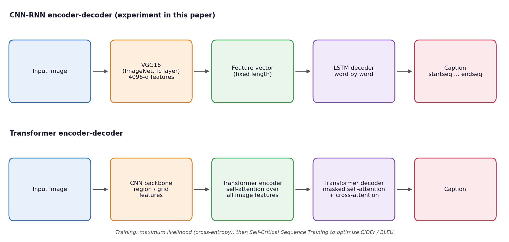
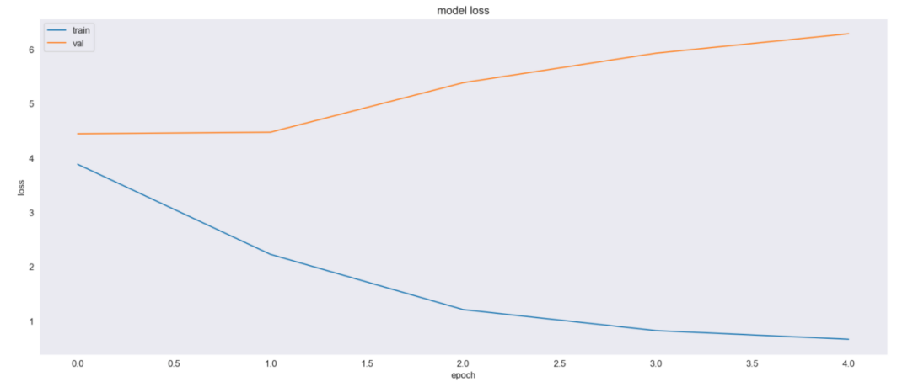
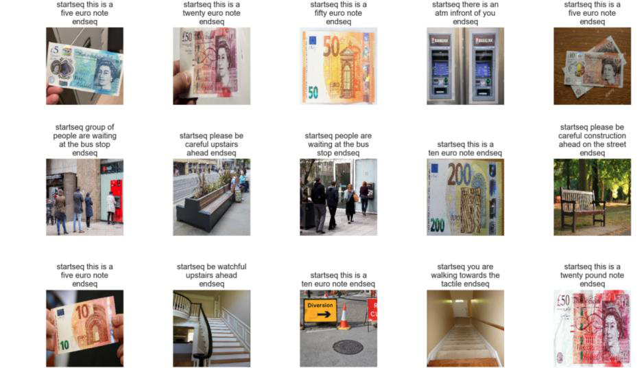

<div align="center">

# Image Captioning: Transforming Objects into Words

**From CNN-RNN encoder-decoders to Transformers: a review of deep-learning image captioning, with a VGG16 + LSTM experiment**


[Read the paper (PDF)](paper/Image_Captioning_Transforming_Objects_into_Words.pdf) · [Open the notebook](code/image_captioning.ipynb)

Farhan Ali Arshad
Trends in Natural Language Processing (NLP Seminar) · Universität Trier · Summer Semester 2024

</div>

---

## Overview

Image captioning sits where computer vision meets natural language processing. A model receives an image and
writes a sentence that names the objects in it, how they relate to each other and the scene they belong to.
Good captions make images accessible to blind and low-vision users, improve content-based image search and
enable richer human-computer interaction.

This paper traces how captioning models developed between 2015 and 2024, compares the two dominant
architecture families on the MSCOCO and Flickr30k benchmarks, and trains a CNN-RNN captioner on an assistive
dataset for visually impaired users (traffic signals, banknotes, ATMs, stairs, bus stops).

**Research question**

> How can image captioning models be optimised to produce more accurate and contextually relevant descriptions?

## Architecture



| | CNN-RNN encoder-decoder | Transformer encoder-decoder |
|---|---|---|
| **Visual encoder** | Pre-trained CNN (VGGNet, ResNet) compresses the image into one fixed-length vector | CNN features are passed as a sequence to a Transformer encoder |
| **Language decoder** | LSTM or GRU generates the caption word by word | Transformer decoder attends to every image feature and every previous word |
| **Strengths** | Fluent, grammatical sentences; light on compute and data | Captures long-range relations between objects; more accurate, context-aware captions |
| **Weaknesses** | Focuses on local dependencies and can miss scene context | Computationally heavy; needs much more training data |

## Experimental setup

| Component | Details |
|---|---|
| **Benchmarks reviewed** | MSCOCO (330,000 images, 5 human captions each) and Flickr30k (30,000 images, 5 captions each) |
| **Experiment data** | Assistive-scene dataset for visually impaired users: 1,600 images with captions, split 80/20 by image; vocabulary of 150 words, captions up to 18 tokens |
| **Feature extraction** | VGG16 pre-trained on ImageNet; 4096-d output of the last fully connected layer |
| **Text preprocessing** | Tokenisation, lowercasing, `startseq` / `endseq` tokens around each caption |
| **Caption model** | Image branch: Dense(256) on VGG16 features. Text branch: Embedding(256). The image vector is prepended to the word sequence, fed to an LSTM(256), added back to the image vector, then Dense(128) and a softmax over the vocabulary; dropout 0.5 |
| **Training** | Custom Keras data generator yielding (image feature, caption prefix) to next-word pairs; categorical cross-entropy, Adam, batch size 64, 5 epochs. Self-Critical Sequence Training (SCST) is discussed for optimising non-differentiable metrics |
| **Decoding** | Greedy search from `startseq` until `endseq` or the maximum length |
| **Evaluation metrics** | BLEU (n-gram overlap), METEOR (synonyms, stemming, paraphrase), CIDEr (consensus with reference captions) |

## Results

### Training behaviour

| Epoch | Training loss | Validation loss |
|:---:|:---:|:---:|
| 1 | 4.2383 | 4.4467 |
| 2 | 2.5820 | 4.4743 |
| 3 | 1.3518 | 5.3856 |
| 4 | 0.8912 | 5.9295 |
| 5 | 0.6910 | 6.2870 |

<p align="center"></p>

Training loss falls from 4.24 to 0.69, while validation loss starts rising after epoch 2 and ends at 6.29.
The widening gap shows that the model memorises the training captions instead of learning features that
generalise.

### Generated captions

| Image | Reference caption | Generated caption |
|---|---|---|
| greensig1.jpg | Green signal please walk. | green signal please walk |
| playing50.jpg | Children at play in the park. | kids are playing in the park |

<p align="center"></p>

On the assistive scenes (banknotes, ATMs, stairs, bus stops, road works; sampled from the training split),
the model describes the scene type reliably ("please be careful upstairs ahead", "people are waiting at the bus stop"),
but confuses fine-grained details, for example reading a 200 euro note as a ten euro note and a 50 pound note as
twenty pounds, even though these images were seen during training.

## Key findings

1. **Transformers outperform CNN-RNN models.** Self-attention relates every image region to every word, which
   gives more accurate and context-appropriate captions.
2. **Attention and strong visual features drive caption quality.** Attention lets the decoder focus on the
   relevant image region for each word it generates.
3. **Small-data training overfits quickly.** Stronger dropout, L2 regularisation, early stopping, data
   augmentation and hyperparameter tuning are needed.
4. **Automatic metrics are imperfect.** BLEU rewards n-gram overlap but captures fluency and coherence poorly;
   METEOR and CIDEr correlate better with human judgement.

## Future work

- Fix the evaluation loop and report BLEU, METEOR and CIDEr on held-out images.
- Regularise the CNN-RNN baseline (early stopping, augmentation) and replace VGG16 with a stronger backbone (ResNet, ViT).
- Train a Transformer captioner on the same data for a direct comparison.
- Add further modalities such as audio and video for richer descriptions.

## Code

The full experiment is in [`code/image_captioning.ipynb`](code/image_captioning.ipynb) (TensorFlow / Keras),
with its original outputs. It covers:

1. Loading and cleaning the caption file, adding `startseq` / `endseq` tokens
2. Tokenisation and an 80/20 train/validation split by image
3. VGG16 feature extraction (penultimate layer, 4096-d) for every image
4. A custom `Sequence` data generator producing next-word training pairs
5. The merge-style CNN + LSTM caption model, training and the loss curve
6. Greedy caption generation and sample predictions
7. A BLEU evaluation cell

Notebook adapted from the seminar project's original upload: <https://github.com/Tayyab304/NLP>.

**Run it**

```bash
pip install tensorflow pandas numpy matplotlib seaborn tqdm nltk
jupyter notebook code/image_captioning.ipynb
```

Set `image_path` and the caption file path in the second and third cells to your copy of the dataset. The dataset
itself is not included in this repository.

### Known limitations of the notebook

- The sample predictions shown above are drawn from the **training** split (`train.sample(15)`), so they show what
  the model memorised, not how it generalises.
- The BLEU cell loops over the DataFrame's column names instead of the test images and reuses the last predicted
  image, so its printed scores (BLEU-1 1.00, BLEU-2 0.93) are not a valid evaluation and are not reported here.
- Images are scaled to [0, 1] instead of using VGG16's `preprocess_input`, which weakens the pre-trained features.
- Early stopping and learning-rate scheduling are defined but commented out, which explains the rising
  validation loss after epoch 2.

## Citation

```bibtex
@misc{arshad2024imagecaptioning,
  title  = {Image Captioning: Transforming Objects into Words},
  author = {Arshad, Farhan Ali},
  year   = {2024},
  note   = {Seminar paper, Trends in Natural Language Processing, Universit{\"a}t Trier}
}
```

## License

The paper and figures are shared for portfolio and educational purposes. Please cite the paper if you use its
content.
